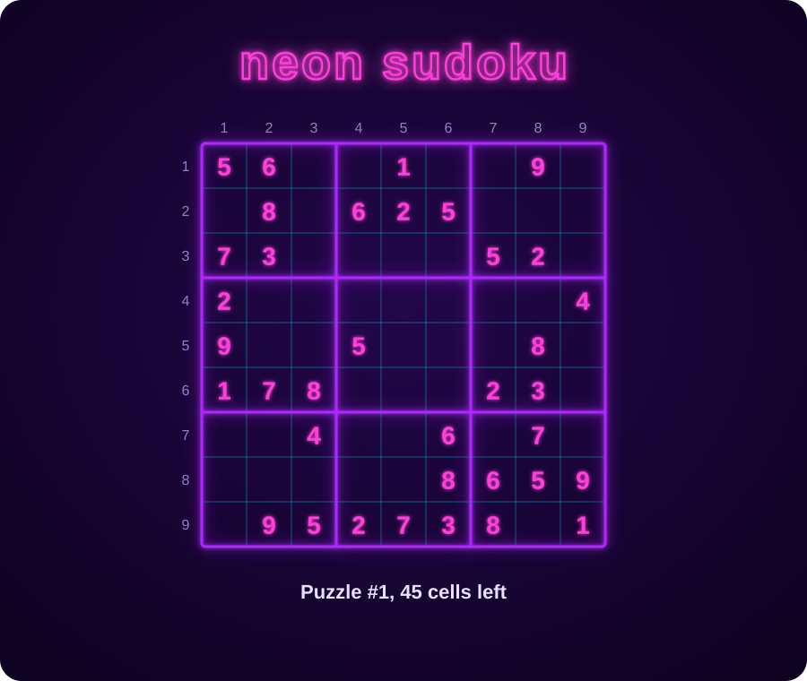

  

<!-- Add your intro, Currently section, and pinned-project notes here -->

<h3 align="center">Pac-Man ate my contributions</h3>

  <picture>
    <source media="(prefers-color-scheme: dark)" srcset="https://raw.githubusercontent.com/reyna07/reyna07/output/pacman-contribution-graph-dark.svg">
    <source media="(prefers-color-scheme: light)" srcset="https://raw.githubusercontent.com/reyna07/reyna07/output/pacman-contribution-graph.svg">
    
  </picture>

  

  

<!-- SUDOKU:START -->

**How to play:** click a **?** in the grid below. A new issue opens; replace the ? at the end of its title with your digit and click Submit. The board updates in about a minute.

|   | 1 | 2 | 3 | 4 | 5 | 6 | 7 | 8 | 9 |
|:-:|:-:|:-:|:-:|:-:|:-:|:-:|:-:|:-:|:-:|
| **1** | 5 | 6 | [**?**](https://github.com/reyna07/reyna07/issues/new?title=sudoku%7Cr1c3%7C%3F&body=Replace+the+%3F+at+the+end+of+the+title+with+a+digit+from+1+to+9%2C+then+click+Submit.+You+don%27t+need+to+write+anything+here.) | [**?**](https://github.com/reyna07/reyna07/issues/new?title=sudoku%7Cr1c4%7C%3F&body=Replace+the+%3F+at+the+end+of+the+title+with+a+digit+from+1+to+9%2C+then+click+Submit.+You+don%27t+need+to+write+anything+here.) | 1 | [**?**](https://github.com/reyna07/reyna07/issues/new?title=sudoku%7Cr1c6%7C%3F&body=Replace+the+%3F+at+the+end+of+the+title+with+a+digit+from+1+to+9%2C+then+click+Submit.+You+don%27t+need+to+write+anything+here.) | [**?**](https://github.com/reyna07/reyna07/issues/new?title=sudoku%7Cr1c7%7C%3F&body=Replace+the+%3F+at+the+end+of+the+title+with+a+digit+from+1+to+9%2C+then+click+Submit.+You+don%27t+need+to+write+anything+here.) | 9 | [**?**](https://github.com/reyna07/reyna07/issues/new?title=sudoku%7Cr1c9%7C%3F&body=Replace+the+%3F+at+the+end+of+the+title+with+a+digit+from+1+to+9%2C+then+click+Submit.+You+don%27t+need+to+write+anything+here.) |
| **2** | [**?**](https://github.com/reyna07/reyna07/issues/new?title=sudoku%7Cr2c1%7C%3F&body=Replace+the+%3F+at+the+end+of+the+title+with+a+digit+from+1+to+9%2C+then+click+Submit.+You+don%27t+need+to+write+anything+here.) | 8 | [**?**](https://github.com/reyna07/reyna07/issues/new?title=sudoku%7Cr2c3%7C%3F&body=Replace+the+%3F+at+the+end+of+the+title+with+a+digit+from+1+to+9%2C+then+click+Submit.+You+don%27t+need+to+write+anything+here.) | 6 | 2 | 5 | [**?**](https://github.com/reyna07/reyna07/issues/new?title=sudoku%7Cr2c7%7C%3F&body=Replace+the+%3F+at+the+end+of+the+title+with+a+digit+from+1+to+9%2C+then+click+Submit.+You+don%27t+need+to+write+anything+here.) | [**?**](https://github.com/reyna07/reyna07/issues/new?title=sudoku%7Cr2c8%7C%3F&body=Replace+the+%3F+at+the+end+of+the+title+with+a+digit+from+1+to+9%2C+then+click+Submit.+You+don%27t+need+to+write+anything+here.) | [**?**](https://github.com/reyna07/reyna07/issues/new?title=sudoku%7Cr2c9%7C%3F&body=Replace+the+%3F+at+the+end+of+the+title+with+a+digit+from+1+to+9%2C+then+click+Submit.+You+don%27t+need+to+write+anything+here.) |
| **3** | 7 | 3 | [**?**](https://github.com/reyna07/reyna07/issues/new?title=sudoku%7Cr3c3%7C%3F&body=Replace+the+%3F+at+the+end+of+the+title+with+a+digit+from+1+to+9%2C+then+click+Submit.+You+don%27t+need+to+write+anything+here.) | [**?**](https://github.com/reyna07/reyna07/issues/new?title=sudoku%7Cr3c4%7C%3F&body=Replace+the+%3F+at+the+end+of+the+title+with+a+digit+from+1+to+9%2C+then+click+Submit.+You+don%27t+need+to+write+anything+here.) | [**?**](https://github.com/reyna07/reyna07/issues/new?title=sudoku%7Cr3c5%7C%3F&body=Replace+the+%3F+at+the+end+of+the+title+with+a+digit+from+1+to+9%2C+then+click+Submit.+You+don%27t+need+to+write+anything+here.) | [**?**](https://github.com/reyna07/reyna07/issues/new?title=sudoku%7Cr3c6%7C%3F&body=Replace+the+%3F+at+the+end+of+the+title+with+a+digit+from+1+to+9%2C+then+click+Submit.+You+don%27t+need+to+write+anything+here.) | 5 | 2 | [**?**](https://github.com/reyna07/reyna07/issues/new?title=sudoku%7Cr3c9%7C%3F&body=Replace+the+%3F+at+the+end+of+the+title+with+a+digit+from+1+to+9%2C+then+click+Submit.+You+don%27t+need+to+write+anything+here.) |
| **4** | 2 | [**?**](https://github.com/reyna07/reyna07/issues/new?title=sudoku%7Cr4c2%7C%3F&body=Replace+the+%3F+at+the+end+of+the+title+with+a+digit+from+1+to+9%2C+then+click+Submit.+You+don%27t+need+to+write+anything+here.) | [**?**](https://github.com/reyna07/reyna07/issues/new?title=sudoku%7Cr4c3%7C%3F&body=Replace+the+%3F+at+the+end+of+the+title+with+a+digit+from+1+to+9%2C+then+click+Submit.+You+don%27t+need+to+write+anything+here.) | [**?**](https://github.com/reyna07/reyna07/issues/new?title=sudoku%7Cr4c4%7C%3F&body=Replace+the+%3F+at+the+end+of+the+title+with+a+digit+from+1+to+9%2C+then+click+Submit.+You+don%27t+need+to+write+anything+here.) | [**?**](https://github.com/reyna07/reyna07/issues/new?title=sudoku%7Cr4c5%7C%3F&body=Replace+the+%3F+at+the+end+of+the+title+with+a+digit+from+1+to+9%2C+then+click+Submit.+You+don%27t+need+to+write+anything+here.) | [**?**](https://github.com/reyna07/reyna07/issues/new?title=sudoku%7Cr4c6%7C%3F&body=Replace+the+%3F+at+the+end+of+the+title+with+a+digit+from+1+to+9%2C+then+click+Submit.+You+don%27t+need+to+write+anything+here.) | [**?**](https://github.com/reyna07/reyna07/issues/new?title=sudoku%7Cr4c7%7C%3F&body=Replace+the+%3F+at+the+end+of+the+title+with+a+digit+from+1+to+9%2C+then+click+Submit.+You+don%27t+need+to+write+anything+here.) | [**?**](https://github.com/reyna07/reyna07/issues/new?title=sudoku%7Cr4c8%7C%3F&body=Replace+the+%3F+at+the+end+of+the+title+with+a+digit+from+1+to+9%2C+then+click+Submit.+You+don%27t+need+to+write+anything+here.) | 4 |
| **5** | 9 | [**?**](https://github.com/reyna07/reyna07/issues/new?title=sudoku%7Cr5c2%7C%3F&body=Replace+the+%3F+at+the+end+of+the+title+with+a+digit+from+1+to+9%2C+then+click+Submit.+You+don%27t+need+to+write+anything+here.) | [**?**](https://github.com/reyna07/reyna07/issues/new?title=sudoku%7Cr5c3%7C%3F&body=Replace+the+%3F+at+the+end+of+the+title+with+a+digit+from+1+to+9%2C+then+click+Submit.+You+don%27t+need+to+write+anything+here.) | 5 | [**?**](https://github.com/reyna07/reyna07/issues/new?title=sudoku%7Cr5c5%7C%3F&body=Replace+the+%3F+at+the+end+of+the+title+with+a+digit+from+1+to+9%2C+then+click+Submit.+You+don%27t+need+to+write+anything+here.) | [**?**](https://github.com/reyna07/reyna07/issues/new?title=sudoku%7Cr5c6%7C%3F&body=Replace+the+%3F+at+the+end+of+the+title+with+a+digit+from+1+to+9%2C+then+click+Submit.+You+don%27t+need+to+write+anything+here.) | [**?**](https://github.com/reyna07/reyna07/issues/new?title=sudoku%7Cr5c7%7C%3F&body=Replace+the+%3F+at+the+end+of+the+title+with+a+digit+from+1+to+9%2C+then+click+Submit.+You+don%27t+need+to+write+anything+here.) | 8 | [**?**](https://github.com/reyna07/reyna07/issues/new?title=sudoku%7Cr5c9%7C%3F&body=Replace+the+%3F+at+the+end+of+the+title+with+a+digit+from+1+to+9%2C+then+click+Submit.+You+don%27t+need+to+write+anything+here.) |
| **6** | 1 | 7 | 8 | [**?**](https://github.com/reyna07/reyna07/issues/new?title=sudoku%7Cr6c4%7C%3F&body=Replace+the+%3F+at+the+end+of+the+title+with+a+digit+from+1+to+9%2C+then+click+Submit.+You+don%27t+need+to+write+anything+here.) | [**?**](https://github.com/reyna07/reyna07/issues/new?title=sudoku%7Cr6c5%7C%3F&body=Replace+the+%3F+at+the+end+of+the+title+with+a+digit+from+1+to+9%2C+then+click+Submit.+You+don%27t+need+to+write+anything+here.) | [**?**](https://github.com/reyna07/reyna07/issues/new?title=sudoku%7Cr6c6%7C%3F&body=Replace+the+%3F+at+the+end+of+the+title+with+a+digit+from+1+to+9%2C+then+click+Submit.+You+don%27t+need+to+write+anything+here.) | 2 | 3 | [**?**](https://github.com/reyna07/reyna07/issues/new?title=sudoku%7Cr6c9%7C%3F&body=Replace+the+%3F+at+the+end+of+the+title+with+a+digit+from+1+to+9%2C+then+click+Submit.+You+don%27t+need+to+write+anything+here.) |
| **7** | [**?**](https://github.com/reyna07/reyna07/issues/new?title=sudoku%7Cr7c1%7C%3F&body=Replace+the+%3F+at+the+end+of+the+title+with+a+digit+from+1+to+9%2C+then+click+Submit.+You+don%27t+need+to+write+anything+here.) | [**?**](https://github.com/reyna07/reyna07/issues/new?title=sudoku%7Cr7c2%7C%3F&body=Replace+the+%3F+at+the+end+of+the+title+with+a+digit+from+1+to+9%2C+then+click+Submit.+You+don%27t+need+to+write+anything+here.) | 4 | [**?**](https://github.com/reyna07/reyna07/issues/new?title=sudoku%7Cr7c4%7C%3F&body=Replace+the+%3F+at+the+end+of+the+title+with+a+digit+from+1+to+9%2C+then+click+Submit.+You+don%27t+need+to+write+anything+here.) | [**?**](https://github.com/reyna07/reyna07/issues/new?title=sudoku%7Cr7c5%7C%3F&body=Replace+the+%3F+at+the+end+of+the+title+with+a+digit+from+1+to+9%2C+then+click+Submit.+You+don%27t+need+to+write+anything+here.) | 6 | [**?**](https://github.com/reyna07/reyna07/issues/new?title=sudoku%7Cr7c7%7C%3F&body=Replace+the+%3F+at+the+end+of+the+title+with+a+digit+from+1+to+9%2C+then+click+Submit.+You+don%27t+need+to+write+anything+here.) | 7 | [**?**](https://github.com/reyna07/reyna07/issues/new?title=sudoku%7Cr7c9%7C%3F&body=Replace+the+%3F+at+the+end+of+the+title+with+a+digit+from+1+to+9%2C+then+click+Submit.+You+don%27t+need+to+write+anything+here.) |
| **8** | [**?**](https://github.com/reyna07/reyna07/issues/new?title=sudoku%7Cr8c1%7C%3F&body=Replace+the+%3F+at+the+end+of+the+title+with+a+digit+from+1+to+9%2C+then+click+Submit.+You+don%27t+need+to+write+anything+here.) | [**?**](https://github.com/reyna07/reyna07/issues/new?title=sudoku%7Cr8c2%7C%3F&body=Replace+the+%3F+at+the+end+of+the+title+with+a+digit+from+1+to+9%2C+then+click+Submit.+You+don%27t+need+to+write+anything+here.) | [**?**](https://github.com/reyna07/reyna07/issues/new?title=sudoku%7Cr8c3%7C%3F&body=Replace+the+%3F+at+the+end+of+the+title+with+a+digit+from+1+to+9%2C+then+click+Submit.+You+don%27t+need+to+write+anything+here.) | [**?**](https://github.com/reyna07/reyna07/issues/new?title=sudoku%7Cr8c4%7C%3F&body=Replace+the+%3F+at+the+end+of+the+title+with+a+digit+from+1+to+9%2C+then+click+Submit.+You+don%27t+need+to+write+anything+here.) | [**?**](https://github.com/reyna07/reyna07/issues/new?title=sudoku%7Cr8c5%7C%3F&body=Replace+the+%3F+at+the+end+of+the+title+with+a+digit+from+1+to+9%2C+then+click+Submit.+You+don%27t+need+to+write+anything+here.) | 8 | 6 | 5 | 9 |
| **9** | [**?**](https://github.com/reyna07/reyna07/issues/new?title=sudoku%7Cr9c1%7C%3F&body=Replace+the+%3F+at+the+end+of+the+title+with+a+digit+from+1+to+9%2C+then+click+Submit.+You+don%27t+need+to+write+anything+here.) | 9 | 5 | 2 | 7 | 3 | 8 | [**?**](https://github.com/reyna07/reyna07/issues/new?title=sudoku%7Cr9c8%7C%3F&body=Replace+the+%3F+at+the+end+of+the+title+with+a+digit+from+1+to+9%2C+then+click+Submit.+You+don%27t+need+to+write+anything+here.) | 1 |

Puzzles completed so far: **0**

<!-- SUDOKU:END -->
