  

<!-- Add your intro, Currently section, and pinned-project notes here -->

<h3 align="center">Pac-Man ate my contributions</h3>

  <picture>
    <source media="(prefers-color-scheme: dark)" srcset="https://raw.githubusercontent.com/reyna07/reyna07/output/pacman-contribution-graph-dark.svg">
    <source media="(prefers-color-scheme: light)" srcset="https://raw.githubusercontent.com/reyna07/reyna07/output/pacman-contribution-graph.svg">
    
  </picture>

  

  

